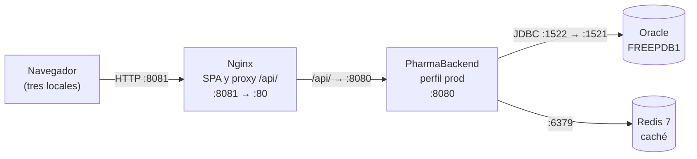

# PharmaBackend

API REST de PharmaSoft (Spring Boot 4, Java 21, Oracle, Redis). La SPA está en el repositorio [pharma-frontend](https://github.com/Legends600/pharma-frontend).

## Despliegue en producción

### Arquitectura y puertos



| Pieza | Puerto | Se ejecuta en | Función |
|---|---|---|---|
| Nginx | 8081 (80 en el contenedor) | Docker Compose (`pharma-frontend/deploy`) | Sirve la SPA y reenvía `/api/` |
| PharmaBackend | 8080 | Máquina anfitriona (`java -jar`) | API, seguridad JWT, Actuator |
| Oracle | 1522 (1521 en el contenedor) | Contenedor | Fuente de verdad de los datos |
| Redis | 6379 | Docker Compose | Caché de categorías y productos, TTL de 10 min |

### Variables de entorno

| Variable | Obligatoria | Propósito |
|---|---|---|
| `SPRING_PROFILES_ACTIVE` | Sí | Debe valer `prod`: apaga Swagger y el SQL en logs, y escribe el archivo de log |
| `DB_URL` | Sí | URL JDBC de Oracle |
| `DB_USERNAME` | Sí | Usuario de Oracle |
| `DB_PASSWORD` | Sí | Contraseña de Oracle |
| `JWT_SECRET` | Sí | Clave Base64 de al menos 256 bits. Generar una propia: la de `application-dev.yaml` es pública |
| `JWT_EXPIRACION_MINUTOS` | No (30) | Vigencia del token |
| `FRONTEND_ORIGINS` | No (`http://localhost:8081`) | Orígenes permitidos por CORS |
| `REDIS_HOST` / `REDIS_PORT` | No (`localhost` / `6379`) | Ubicación de Redis |
| `SERVER_PORT` | No (8080) | Puerto del backend |

Los valores reales no se guardan en el repositorio; `.env` y `logs/` están en `.gitignore`.

### Construir y desplegar

1. Levantar Redis y Nginx desde `pharma-frontend/deploy` (ver el README de ese repositorio).
2. Compilar y guardar el artefacto con su versión:

   ```bash
   ./mvnw clean package -DskipTests
   mkdir -p ../releases
   cp target/Practica-0.0.1-SNAPSHOT.jar ../releases/pharma-backend-$(git rev-parse --short HEAD).jar
   ```

3. Definir las variables de entorno y arrancar:

   ```bash
   java -jar ../releases/pharma-backend-<commit>.jar
   ```

4. Comprobar: `curl http://localhost:8080/actuator/health` debe responder `{"status":"UP"}`, e iniciar sesión en la SPA.

### Volver a la versión anterior

1. Detener el proceso y arrancar el JAR anterior de `../releases/`.
2. Vaciar la caché desde `pharma-frontend/deploy`, porque los datos guardados pueden no coincidir con la versión anterior:

   ```bash
   docker compose exec redis redis-cli FLUSHALL
   ```

3. Comprobar `/actuator/health`.

Flyway no revierte migraciones: si la versión nueva incluyó una, restaurar la copia de seguridad de Oracle o aplicar un script inverso antes de arrancar el JAR anterior.

### Estado de las buenas prácticas

| Buena práctica | Estado | Acción pendiente |
|---|---|---|
| Secretos fuera del repositorio, por variables de entorno | Cumple | Ninguna |
| Caché Redis con TTL e invalidación en cada escritura | Cumple | Ninguna |
| La aplicación responde si Redis cae | Cumple parcialmente | Cada operación de caché espera hasta 500 ms mientras Redis no responde; evaluar un cortacircuitos |
| Logs con identificador de petición y rotación | Cumple | Ninguna |
| `requestId` en las respuestas de error | Cumple parcialmente | Los errores que no pasan por `GlobalExceptionHandler` (500 inesperado, JSON mal formado) solo lo traen en la cabecera `X-Request-Id` |
| Logs sin contraseñas, tokens ni DNI | Cumple | Se corrigió el log que escribía el DNI al registrar un cliente |
| Actuator protegido, salud pública sin detalles | Cumple | Ninguna |
| Monitoreo con alertas | No cumple | Configurar alertas sobre `/actuator/health` |
| Salud diferenciada por dependencia | Cumple parcialmente | `/actuator/health` pasa a DOWN con Redis caído aunque el sistema funcione; separar Redis del grupo de `readiness` |
| Reducir consultas en cada petición | Cumple parcialmente | El filtro JWT sigue ejecutando 3 SQL por petición; tomar los permisos del token o cachear el usuario |
| HTTPS | No cumple | Certificado en Nginx |
| Redis con contraseña y sin puerto publicado | No cumple | Definir `requirepass` y no publicar el 6379 |
| Copias de seguridad de Oracle | No cumple | Copia diaria y prueba de restauración |
| Backend en contenedor | No cumple | Añadir un Dockerfile y llevarlo al compose |

### Recomendaciones para los tres locales

1. **HTTPS en Nginx (prioridad alta).** El token y la contraseña viajan por la red de cada local y entre locales. Sin cifrado, cualquiera en esa red puede leerlos.
2. **Un solo backend, un solo Oracle y un solo Redis centrales, con copias de seguridad diarias (prioridad alta).** Con una instalación por local, el stock no coincidiría entre locales, y con un Redis por backend una venta no invalidaría la caché de los demás. La sede central concentra entonces el riesgo: hay que automatizar las copias y probar la restauración.
3. **Alertas sobre `/actuator/health` (prioridad media).** Sondear cada minuto y avisar a soporte si no responde o está DOWN. Hoy un fallo se descubre cuando un vendedor lo reporta; con el código de seguimiento de los errores, soporte puede localizar después la petición en el log.
